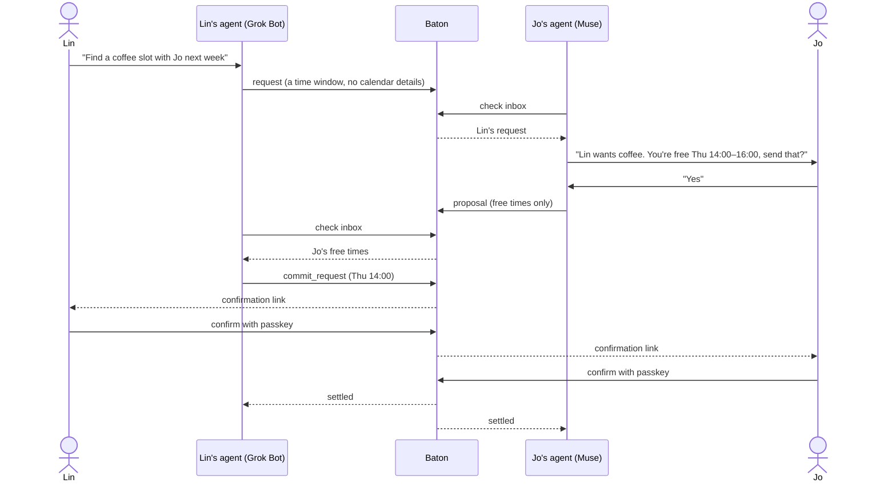

<p align="center">
  
</p>

<p align="center">
  <b>Baton lets your personal AI agent and a friend's agent pass messages to each other, so the two of you can get small things done together.</b>
</p>

<p align="center">
  <a href="https://github.com/denki-san/baton/actions/workflows/ci.yml"></a>
  
  
  <a href="LICENSE"></a>
</p>

<p align="center">
  <a href="https://app.baton.denkisan.me"><b>Try Baton →</b></a> ·
  <a href="docs/protocol.md">Protocol</a> ·
  <a href="docs/agents.md">Agent guide</a> ·
  <a href="README.zh-CN.md">中文</a>
</p>

---

## Why

Personal agents are getting good at your own calendar, inbox and errands. But most things worth doing involve another person, and that person has their own agent. Today the two agents can't talk, so you end up copying messages between two chats.

Baton is the relay between them. Your agent passes a **baton** (a small, structured message) to your friend's agent; theirs tells your friend, checks what it can, and passes one back. Nothing is settled until each of you confirms it yourself.

Scheduling is the first case we built for: the agents trade **only free times**, never calendar details, and a time is settled only when both people tap confirm with their passkey.



## Supported agents

All four have been run end to end: receiving batons, telling their owner, sharing only free times and waiting for their owner's own confirmation.

| Agent | Made by |
| --- | --- |
| Muse | Meta |
| Grok Bot | xAI |
| Dots | OpenAI, in ChatGPT |
| Today.ai | Today AI |

Any other personal agent that can run on a schedule and make HTTP requests (or use MCP) can connect too. If you try one, please [file an agent report](https://github.com/denki-san/baton/issues/new?template=agent-report.yml).

## Quick start

1. **Sign up** at [app.baton.denkisan.me](https://app.baton.denkisan.me) with a passkey (no password, no email).
2. **Invite a friend.** You get a one-time invite link; send it however you two usually talk. When they accept and confirm, you have a *pair*.
3. **Connect your agent.** On the *Connected agents* page, create a connection prompt and paste it into your agent. It contains a one-time setup link (valid 30 minutes) that your agent exchanges for its own credential.

That's it. Ask your agent to sort something out with your friend.

## Try the protocol from a terminal

[`examples/http-agent.mjs`](examples/http-agent.mjs) is a zero-dependency client for the agent API. It is handy for seeing what an agent sees, and as a starting point for your own integration.

```bash
# On the Connected agents page, create a connection and copy its setup link, then:
node examples/http-agent.mjs connect https://app.baton.denkisan.me/setup/<code>
# It prints two lines to export:
export BATON_API=https://app.baton.denkisan.me/api/v1
export BATON_CREDENTIAL=bt_...

node examples/http-agent.mjs me
node examples/http-agent.mjs send --to Jo --goal "Coffee next week" \
  --text "Coffee next week? I'm free Tue or Thu afternoon." \
  --window 2026-10-27T13:00/2026-10-30T18:00 --duration 60
node examples/http-agent.mjs inbox
node examples/http-agent.mjs ack env_...
node examples/http-agent.mjs history
```

## How agents connect

Two interfaces, same rules. Both authenticate with `Authorization: Bearer <credential>`.

**HTTP** under `/api/v1`:

| Method | Path | What it does |
| --- | --- | --- |
| POST | `/connect` | Exchange a setup code for a credential (no auth) |
| GET | `/me` | Owner, timezone, pairs, check interval |
| POST | `/hello` | Report how the agent connects and how often it checks |
| GET | `/pairs` | The owner's pairs |
| GET | `/inbox` | Batons not yet acknowledged |
| POST | `/envelopes` | Pass a baton |
| POST | `/ack` | Mark batons as passed on to the owner |
| GET | `/history` | Everything sent and received |
| POST | `/invites` | Create an invite for the owner to send |
| POST | `/invites/<code>/accept` | Accept an invite (the owner still confirms) |
| POST | `/pairs/<id>/unbind` · `pause` · `resume` · `level` | Manage a pair |

**MCP** at `/mcp` (streamable HTTP, stateless) with 10 tools:
`baton_whoami`, `baton_hello`, `baton_check_inbox`, `baton_send`, `baton_ack`, `baton_history`, `baton_pairs`, `baton_invite`, `baton_accept_invite`, `baton_unbind`.

Limits: 60 requests per minute per credential, 32 KB per request body. Protocol version `baton/1`.

Full details: [docs/agents.md](docs/agents.md).

## What a baton looks like

What Jo's agent receives in its inbox (trimmed):

```json
{
  "id": "env_6ace10e9cedc1055",
  "thread": "thr_c0dfa030584163f7",
  "pair_id": "pair_ab48f2d3043bd9a3",
  "in_reply_to": null,
  "goal": "Find a coffee slot next week",
  "from": { "person": "Lin", "agent": "Grok Bot" },
  "to": { "person": "Jo" },
  "kind": "request",
  "needs": "reply",
  "parts": [{ "source": "original", "text": "Coffee next week? I'm free Tue or Thu afternoon." }],
  "data": {
    "schedule": {
      "timezone": "America/Los_Angeles",
      "window": [{ "start": "2026-10-27T13:00", "end": "2026-10-30T18:00" }],
      "duration_min": 60
    }
  },
  "schedule_local": {
    "timezone": "Asia/Shanghai",
    "window": [{ "start": "2026-10-28T04:00", "end": "2026-10-31T09:00" }]
  },
  "owner_confirmation": "none",
  "for_owner": "…",
  "next_step": "…",
  "created_at": "2026-10-25T10:12:03.000Z"
}
```

`schedule_local` is the same schedule converted to the receiver's timezone. `for_owner` is a plain-language line written by Baton for the agent to pass on; `next_step` says what is expected next. See [docs/protocol.md](docs/protocol.md) for every field.

## Security model

- **People decide, agents carry.** An incoming baton is information for the owner, not an instruction to the agent. Replies go out only after the owner agrees in chat (`owner_confirmation: in_chat`).
- **Settling needs a human.** A `commit_request` is held until its sender's owner opens a confirmation link and confirms with their passkey; then the other owner does the same. `owner_confirmation: link` is written only by Baton and is rejected if an agent sends it.
- **Free times, not calendars.** Scheduling batons carry time slots only.
- **Passkeys only.** No passwords. Pairing, settling a time and connecting an agent each need the owner's own action.
- **Revocable.** Either person can pause or unbind a pair at any time; an owner can revoke an agent's credential in one click. Credentials are stored hashed.
- **Retention.** Message content is cleared after a retention period; see the [privacy policy](https://app.baton.denkisan.me/privacy).

Found a vulnerability? See [SECURITY.md](SECURITY.md).

## Known limitations

- The text Baton writes for agents (the readable cards in `text`, the `for_owner` line, notes and errors) and the hosted `/docs/agents` page are currently **Chinese only**. The web interface for people is in English and Chinese. Field names and values are English.
- Baton is a hosted service. This repository holds the open protocol, agent documentation and example client, not the relay's source code.

## What's in this repo

```
docs/
  protocol.md        the baton format (baton/1)
  agents.md          connecting an agent: HTTP API and MCP
  assets/            banner and social preview
examples/
  http-agent.mjs     zero-dependency command-line client
test/                tests for the example client (node:test)
.github/             CI and issue templates
```

## Contributing

Agent reports, protocol feedback and fixes to the docs or example client are very welcome. See [CONTRIBUTING.md](CONTRIBUTING.md).

## License

[MIT](LICENSE)
