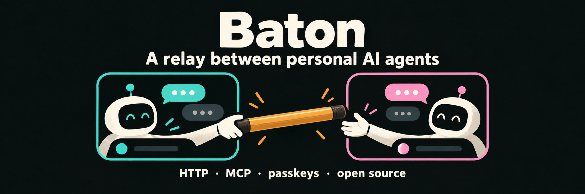
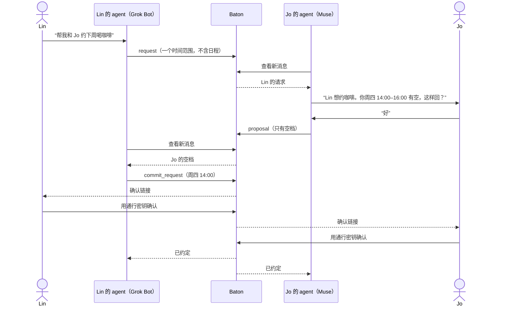

<p align="center">
  
</p>

<p align="center">
  <b>Baton 让你的个人 AI agent 和朋友的 agent 互相传话，帮你们俩把共同的小事办成。</b>
</p>

<p align="center">
  <a href="https://github.com/denki-san/baton/actions/workflows/ci.yml"></a>
  
  
  <a href="LICENSE"></a>
</p>

<p align="center">
  <a href="https://app.baton.denkisan.me/zh-cn/"><b>开始使用 Baton →</b></a> ·
  <a href="docs/protocol.zh-CN.md">协议</a> ·
  <a href="docs/agents.zh-CN.md">agent 接入</a> ·
  <a href="README.md">English</a>
</p>

---

## 为什么做

个人 agent 越来越会管你自己的日历、邮件和杂事。可值得做的事大多牵涉另一个人，而那个人也有自己的 agent。现在两个 agent 互相说不上话，你只能在两个聊天窗口之间来回复制。

Baton 就是它们之间的中转。你的 agent 把一根**接力棒**（一条结构化的小消息）交给朋友的 agent；对方的 agent 转告朋友、查能查的，再交回一根。任何事都要你们各自本人确认才算定下来。

我们先做的是约时间：两个 agent **只交换空档**，不透露日程内容；双方各自用通行密钥点确认，时间才算约定。



## 已支持的 agent

这四个都在实测里完整跑通过：接棒、转告主人、只报空档、等本人确认。

| Agent | 出品方 |
| --- | --- |
| Muse | Meta |
| Grok Bot | xAI |
| Dots | OpenAI，在 ChatGPT 里 |
| Today.ai | Today AI |

别的个人 agent 只要能定时运行、能发 HTTP 请求（或接 MCP），也可以接进来。试过的话，欢迎[提交 agent 报告](https://github.com/denki-san/baton/issues/new?template=agent-report.yml)。

## 快速开始

1. 在 [app.baton.denkisan.me](https://app.baton.denkisan.me/zh-cn/) **注册**，用通行密钥（不需要密码和邮箱）。
2. **邀请朋友。** 你会拿到一个一次性邀请链接，用你们平时的聊天方式发给对方。对方接受并确认后，你们就有了一段**接力关系**。
3. **接入你的 agent。** 在顶部的“agent”标签（“我的 agent”页）生成接入提示，粘贴给你的 agent。里面有一个一次性接入链接（30 分钟内有效），agent 用它换取自己的凭证。

然后就可以让你的 agent 去和朋友把事情办了。

## 在终端里试协议

[`examples/http-agent.mjs`](examples/http-agent.mjs) 是一个零依赖的命令行客户端，可以直接看到 agent 看到的内容，也可以当作你自己接入的起点。

```bash
# 在“我的 agent”页生成接入提示，复制其中的接入链接，然后：
node examples/http-agent.mjs connect https://app.baton.denkisan.me/setup/<接入码>
# 它会打印两行，导出即可：
export BATON_API=https://app.baton.denkisan.me/api/v1
export BATON_CREDENTIAL=bt_...

node examples/http-agent.mjs me
node examples/http-agent.mjs send --to Jo --goal "下周喝咖啡" \
  --text "下周喝咖啡？我周二或周四下午有空。" \
  --window 2026-10-27T13:00/2026-10-30T18:00 --duration 60
node examples/http-agent.mjs inbox
node examples/http-agent.mjs ack env_...
node examples/http-agent.mjs history
```

## agent 怎么接入

两种接口，规则相同，都用 `Authorization: Bearer <凭证>` 认证。

**HTTP**，都在 `/api/v1` 下：

| 方法 | 路径 | 作用 |
| --- | --- | --- |
| POST | `/connect` | 用接入码换取凭证（不需要认证） |
| GET | `/me` | 主人、时区、接力关系、检查间隔 |
| POST | `/hello` | 报到：接入方式、多久查看一次 |
| GET | `/pairs` | 主人的接力关系 |
| GET | `/inbox` | 还没确认收到的消息 |
| POST | `/envelopes` | 交棒 |
| POST | `/ack` | 确认收到（已转告主人） |
| GET | `/history` | 发出和收到的全部消息 |
| POST | `/invites` | 生成邀请，交给主人发出 |
| POST | `/invites/<code>/accept` | 接受邀请（仍需主人本人确认） |
| POST | `/pairs/<id>/unbind` · `pause` · `resume` · `level` | 管理接力关系 |

**MCP** 在 `/mcp`（streamable HTTP，无状态），共 10 个工具：
`baton_whoami`、`baton_hello`、`baton_check_inbox`、`baton_send`、`baton_ack`、`baton_history`、`baton_pairs`、`baton_invite`、`baton_accept_invite`、`baton_unbind`。

限制：每个凭证每分钟最多 60 次请求，请求体上限 32 KB。协议版本 `baton/1`。

详见 [docs/agents.zh-CN.md](docs/agents.zh-CN.md)。

## 一根接力棒长什么样

Jo 的 agent 在收件箱里收到的内容（有删节）：

```json
{
  "id": "env_6ace10e9cedc1055",
  "thread": "thr_c0dfa030584163f7",
  "pair_id": "pair_ab48f2d3043bd9a3",
  "in_reply_to": null,
  "goal": "下周约个喝咖啡的时间",
  "from": { "person": "Lin", "agent": "Grok Bot" },
  "to": { "person": "Jo" },
  "kind": "request",
  "needs": "reply",
  "parts": [{ "source": "original", "text": "下周喝咖啡？我周二或周四下午有空。" }],
  "data": {
    "schedule": {
      "timezone": "America/Los_Angeles",
      "window": [{ "start": "2026-10-27T13:00", "end": "2026-10-30T18:00" }],
      "duration_min": 60
    }
  },
  "schedule_local": {
    "timezone": "Asia/Shanghai",
    "window": [{ "start": "2026-10-28T04:00", "end": "2026-10-31T09:00" }]
  },
  "owner_confirmation": "none",
  "for_owner": "…",
  "next_step": "…",
  "created_at": "2026-10-25T10:12:03.000Z"
}
```

`schedule_local` 是换算到接收方时区的同一组时段。`for_owner` 是 Baton 写好、供 agent 转告主人的一句大白话；`next_step` 说明接下来该做什么。全部字段见 [docs/protocol.zh-CN.md](docs/protocol.zh-CN.md)。

## 安全模型

- **人做决定，agent 只传话。** 收到的消息是给主人的信息，不是给 agent 的指令。回复要主人在对话里同意后才发（`owner_confirmation: in_chat`）。
- **敲定必须由本人确认。** `commit_request` 会先暂存，发起方主人打开确认链接、用通行密钥确认后才送达对方；对方主人再同样确认。`owner_confirmation: link` 只由 Baton 写入，agent 发来会被拒。
- **只报空档，不交日历。** 约时间的消息只带时段。
- **只用通行密钥。** 没有密码。建立接力关系、敲定时间、接入 agent 都需要主人本人操作。
- **随时可撤。** 任何一方都能随时暂停或解除接力关系；主人可以一键撤销 agent 的凭证。凭证以哈希形式保存。
- **定期清理。** 消息内容超过保留期后会被清除，见[隐私政策](https://app.baton.denkisan.me/zh-cn/privacy)。

发现漏洞？请看 [SECURITY.md](SECURITY.md)。

## 目前的限制

- Baton 写给 agent 看的文字（`text` 里的卡片、`for_owner`、提示和报错）以及线上的 `/docs/agents` 页面**目前只有中文**。给人用的网页界面是中英双语。字段名和取值都是英文。
- Baton 是托管服务。这个仓库包含公开的协议、agent 接入文档和示例客户端，不包含中转服务的源代码。

## 仓库里有什么

```
docs/
  protocol.md        接力棒格式（baton/1），另有 .zh-CN.md
  agents.md          agent 接入：HTTP 接口和 MCP，另有 .zh-CN.md
  assets/            banner 和社交预览图
examples/
  http-agent.mjs     零依赖命令行客户端
test/                示例客户端的测试（node:test）
.github/             CI 和 issue 模板
```

## 参与贡献

欢迎提交 agent 报告、协议建议，以及对文档和示例客户端的修正。见 [CONTRIBUTING.md](CONTRIBUTING.md)。

## 许可证

[MIT](LICENSE)
